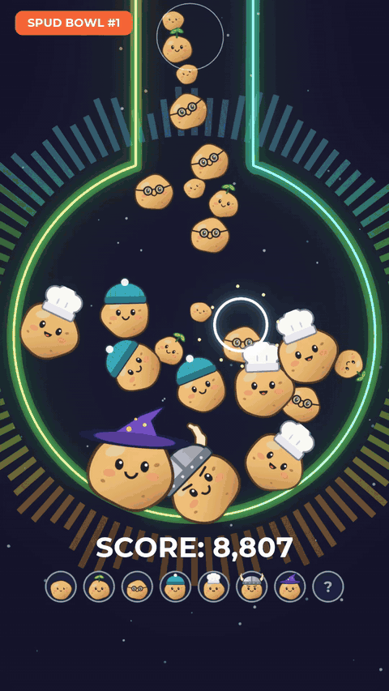
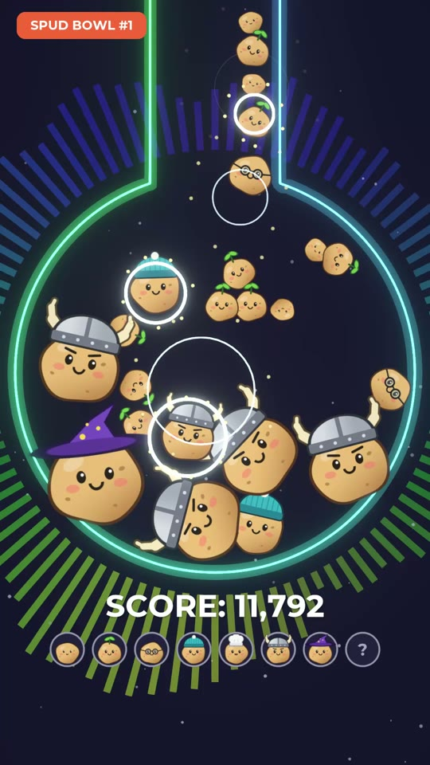
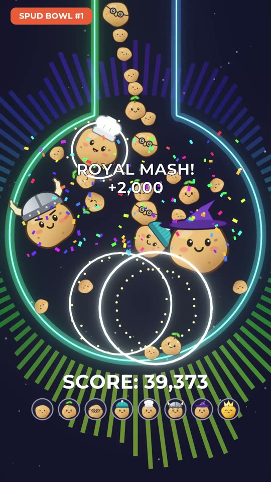

# Spud Bowl

Pour little spuds into a neon bowl, merge equal ones into bigger ones, and reach the Golden King before the bowl fills up.

  
  

## How to play

- **Pour:** hold the mouse or touch (or **Space** / **Down**) to pour a stream of spuds into the bowl. Drag left and right (or **A/D**, **Left/Right**) to aim the spout.
- **Merge:** two equal spuds that touch pop into the next kind. There are 8 kinds: Nub, Sprout, Specs, Beanie, Chef, Viking, Wizard and Golden King. Each new kind fills its slot in the row under the score.
- **Royal Mash:** two Golden Kings that touch burst for +2,000 with confetti and clear space.
- **Goal:** score as high as you can. If the spuds cover more than 60% of the bowl for 2.5 seconds, the run ends with "BOWL FULL!". Tap or press **Space / R** to pour again.

## How to open it

1. Open the folder in **Unity 6000.5.4f1** (URP, Input System). Unity restores the packages from `Packages/manifest.json`.
2. Open the scene `Assets/SpudBowl/Scenes/SpudBowl.unity`.
3. Press **Play**.

All spud characters, the UI and the effects are drawn procedurally in code (`Assets/SpudBowl/Scripts/SpudArt.cs`). The Satura Space editor hooks are inside `#if UNITY_EDITOR && SATURA_SPACE`, so the project opens and plays in plain Unity.

## Created by Satura Space

This game was made with [Satura Space](https://github.com/saturadev/satura-space) ([saturaspace.com](https://saturaspace.com)), a free, open source tool that turns a clip into a playable game. A TikTok link ([inspired by @cool_games_heel](https://www.tiktok.com/@cool_games_heel/video/7711352298953379094)) was pasted into Satura Space. A Claude agent watched the clip's frames, searched GitHub for how others solved the core mechanic (physics merging), built the game in Unity, playtested it with a bot and filmed it.

## Model and cost

Claude Opus 5.5 (xhigh effort) in Claude Code. At Anthropic API list prices this run would have cost about **$8.19**. That is an estimate: 324 input tokens, 106,381 output tokens, 19,270,998 cache-read tokens and 275,659 cache-write tokens (1 hour), summed across every session for the game.

## Credits

- Idea: [@cool_games_heel](https://www.tiktok.com/@cool_games_heel/video/7711352298953379094) on TikTok.
- Merge technique (a merging flag per body, one side of the pair performs the merge, the next tier spawns at the midpoint, a tier table with radius and score) adapted from [GeonhanLee/SputnikaGame-GameOff2023](https://github.com/GeonhanLee/SputnikaGame-GameOff2023), MIT licence. It was written fresh for this game; no code or assets were copied.
- Tier radius and score ideas only: [demouth/suika-game-go](https://github.com/demouth/suika-game-go) and [F-star/suika](https://github.com/F-star/suika), both MIT.
- Game code and art are original and released under the MIT licence.
- Font: [Montserrat Bold](https://github.com/JulietaUla/Montserrat), (c) 2011 The Montserrat Project Authors, SIL Open Font License 1.1.
- TextMesh Pro Essential Resources (Unity package content) include Liberation Sans, SIL Open Font License 1.1.
